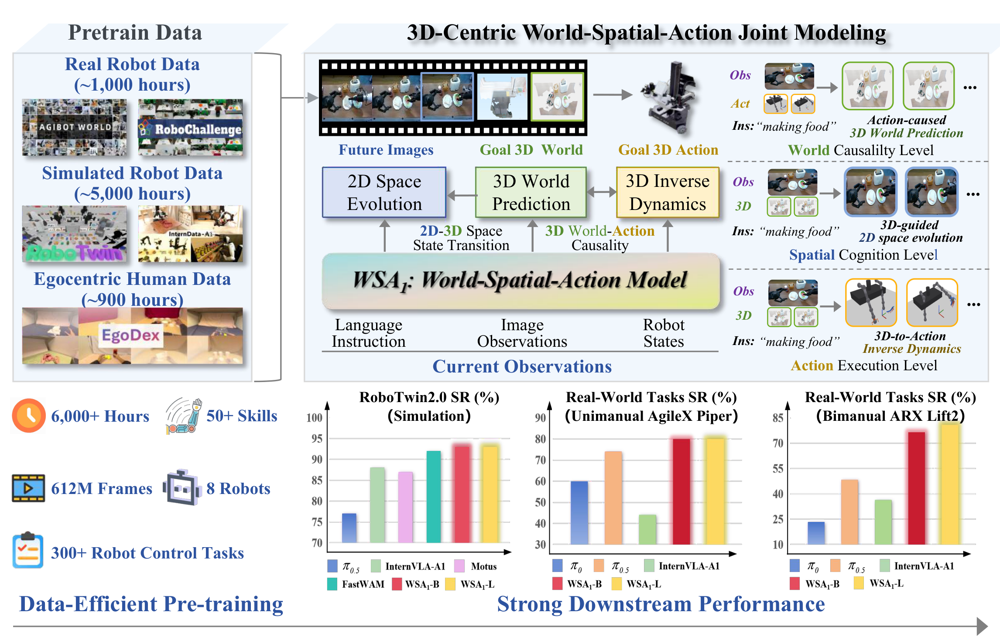
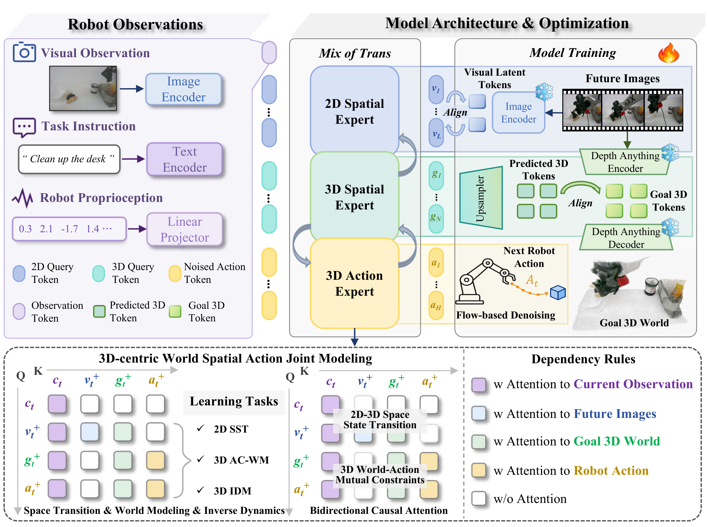
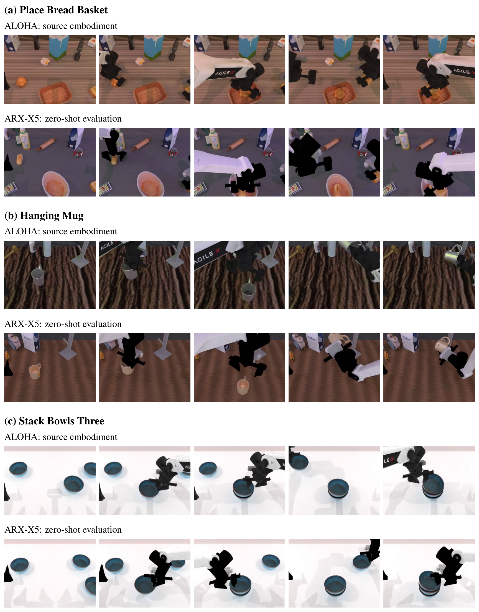
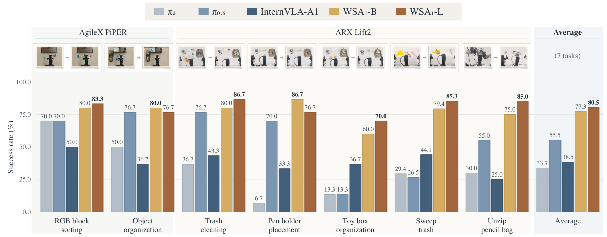

<h1 align="center">WSA: A 3D-Centric World-Spatial-Action Model<br>for Generalizable Robot Control</h1>

<p align="center">
  
</p>

<p align="center">
  An embodied foundation model that introduces <strong>World-Spatial-Action</strong> modeling
  to unify instruction-aligned 2D visual planning,
  action-conditioned 3D world modeling, and 3D-aware action generation.
</p>

<p align="center">
  <a href="https://zaleni.github.io/WSA1/"></a>
  <a href="https://github.com/zaleni/WSA"></a>
  <a href="https://arxiv.org/abs/2607.03941"></a>
  <a href="https://huggingface.co/collections/zaleni/wsa1"></a>
  <a href="https://robochallenge.ai/competition/cvpr"></a>
</p>

<br>

<p align="center">
  
</p>

<a id="news"></a>

## 🗞️ News

- [2026-07-06]: 🚀 Released **WSA-Large** code, weights, benchmark results, and
  training/evaluation workflows for the 6B Wan2.2-based WSA model.
- [2026-05-31]: 🎉 Released the WSA-Base training, evaluation, and inference code.
- [2026-05-31]: 🤗 Released the WSA-Base Hugging Face model collection, including
  Base, RoboTwin, and LIBERO checkpoints.
- [2026-05-18]: 🏆 **WSA ranked 4th out of 100+ teams on the [RoboChallenge CVPR 2026 leaderboard](https://robochallenge.ai/competition/cvpr)** with fully open-source weights and code. (Team: MagicBot)

<a id="todo-list"></a>

## TODO List

- [x] Provide RoboTwin, LIBERO, and real-world robot example inference workflows.
- [x] Release WSA policy code and fine-tuning scripts.
- [x] Release WSA pretraining scripts.
- [x] **Release the WSA-Large code for the 6B WSA model based on the Wan2.2 model backbone.**
- [x] **Release WSA-Large weights and benchmark results.**
- [x] Release the arXiv paper and citation.
- [ ] Provide the training and evaluation codes on **RoboChallenge2.0**.
- [ ] Release **WSA1.5**, our **next-generation foundation model**, pretrained on **larger and more diverse datasets** with **memory capabilities** for hard and long-horizon robotic tasks.


## Table of Contents
- [Framework](#framework)
- [Results](#results)
  - [RoboTwin 2.0](#robotwin-20)
  - [LIBERO](#libero)
  - [Clean2Random Generalization](#clean2random-generalization-ood-c2r)
  - [ARX-X5 Zero-Shot Transfer](#arx-x5-zero-shot-transfer-ood-ce)
  - [Real-Robot Manipulation](#real-robot-manipulation)
- [Repository Layout](#repository-layout)
- [Installation](#installation)
- [Model Zoo](#model-zoo)
- [Choosing a Model](#choosing-a-model)
- [Inference](#inference)
- [Training](#training)
  - [RoboTwin Fine-tuning](#robotwin-fine-tuning)
  - [Fine-tuning example](#fine-tuning-example)
  - [WSA-Large Fine-tuning](#wsa-large-fine-tuning)
  - [Multi-Dataset Pretraining](#multi-dataset-pretraining)
- [Acknowledgments](#acknowledgments)
- [Citation](#citation)

## Framework

<p align="center">
  
</p>

WSA is a **World-Spatial-Action (WSA)** embodied foundation model for
generalizable robot control. It learns a shared 2D-3D latent space that connects
instruction-aligned **visual planning**, action-conditioned **3D world prediction**,
and 3D-aware **action generation**.

### 🌟 Highlights:

- **Unified World-Spatial-Action Modeling:** WSA unifies semantic understanding, 3D world modeling, and physical
  execution.
- **Bidirectional 3D Causality:** WSA learns both action-conditioned scene dynamics and
  3D inverse dynamics.
- **Mixture-of-Transformers:** WSA coordinates 2D planning, 3D prediction, and 3D action
  generation with shared dependency rules.
- **Data-Efficient Pretraining:** Pretraining on 6,000 demonstration hours yields strong
  simulation and real-world manipulation performance.
- **Superior Performance:** State-of-the-art results across simulation
  and real-world robot manipulation tasks, achieved by our open-source model.

## Results

### RoboTwin 2.0

Success rates averaged over 50 simulated ALOHA manipulation tasks in the
randomized setting.

| Metric | π0 | π0.5 | ABot-M0 | Motus | InternVLA-A1 | LingBot-VA | Fast-WAM | **WSA-B** | **WSA-L** |
| --- | ---: | ---: | ---: | ---: | ---: | ---: | ---: | ---: | ---: |
| Avg. Success (Randomized) | 58.4% | 76.8% | 85.1% | 87.0% | 89.6% | 91.6% | 91.8% | 92.7% | **93.1%** |

### LIBERO

Success rates (%) across spatial, object, goal, and long-horizon(Libero-10) manipulation. Avg. is the mean over the four suites.

| Method | Spatial ↑ | Object ↑ | Goal ↑ | Long ↑ | Avg. ↑ |
| --- | ---: | ---: | ---: | ---: | ---: |
| π0.5 | 98.8 | 98.2 | 98.0 | 92.4 | 96.9 |
| OpenVLA-OFT | 97.6 | 98.4 | 97.9 | 94.5 | 97.1 |
| ABot-M0 | 98.8 | 99.8 | **99.0** | 96.6 | **98.6** |
| Motus | 96.8 | 99.8 | 96.6 | 97.6 | 97.7 |
| LingBot-VA | 98.5 | 99.6 | 97.2 | **98.5** | 98.5 |
| Fast-WAM | 98.2 | **100.0** | 97.0 | 95.2 | 97.6 |
| **WSA-B** | 98.6 | 99.6 | 97.2 | 94.2 | 97.4 |
| **WSA-L** | **99.4** | 99.8 | 98.0 | 95.6 | 98.2 |

### Clean2Random Generalization (OOD-C2R)

All models are fine-tuned **only on clean demonstrations(2,500 episodes in total)**, then evaluated in
both clean and randomized scenes.

| Method | Clean SR (%) ↑ | Randomized SR (%) ↑ | Avg. SR (%) ↑ | Drop (pp) ↓ |
| --- | ---: | ---: | ---: | ---: |
| π0.5 | 70.7 | 46.0 | 58.4 | 24.7 |
| ABot-M0 | 57.4 | 30.4 | 43.9 | 27.0 |
| RobotManip | 73.2 | 62.6 | 67.9 | 10.6 |
| Fast-WAM | 77.8 | 1.9 | 39.9 | 75.9 |
| InternVLA-A1 | **86.6** | 74.6 | 80.6 | 12.0 |
| **WSA-B** | 83.8 | **77.8** | **80.8** | **6.0** |


### ARX-X5 Zero-Shot Transfer (OOD-CE)

Policies are fine-tuned on ALOHA data and transferred to the **unseen ARX-X5**
without target-robot policy fine-tuning. Methods are evaluated over 45 tasks with 100 episodes per
task.

| Method | Clean SR (%) ↑ | Randomized SR (%) ↑ | Avg. SR (%) ↑ |
| --- | ---: | ---: | ---: |
| π0.5 | 33.5 | 19.0 | 26.3 |
| LingBot-VA | 17.2 | 16.6 | 16.9 |
| RobotManip | — | 42.9 | 42.9 |
| Fast-WAM | 25.9 | 22.4 | 24.2 |
| InternVLA-A1 | 18.1 | 17.5 | 17.8 |
| **WSA-B** | **47.1** | **47.6** | **47.4** |

<details>
<summary>ALOHA → ARX-X5 execution examples</summary>

<p align="center">
  
</p>

Each task shows an ALOHA rollout followed by an ARX-X5 zero-shot rollout,
with execution progressing from left to right.

</details>

### Real-Robot Manipulation

Seven tabletop tasks span the **7-DoF AgileX PiPER** and **14-DoF bimanual
ARX Lift2**. Success rate (SR) measures full-task completion; completeness (C)
measures the fraction of task stages completed. Both metrics are averaged
equally across the seven tasks.

<p align="center">
  
</p>

| Method | Avg. SR (%) ↑ | Avg. C (%) ↑ |
| --- | ---: | ---: |
| π0 | 33.73 | 43.24 |
| π0.5 | 55.45 | 63.33 |
| InternVLA-A1 | 38.45 | 50.37 |
| **WSA-B** | 77.30 | 82.27 |
| **WSA-L** | **80.52** | **85.21** |


<details>
<summary>Per-task real-robot results</summary>

Each cell gives **SR / C (%)**. All policies use 30 trials per task, except
Sweep Trash (34) and Unzip Pencil Bag (20).

| Task | Robot | π0 | π0.5 | InternVLA-A1 | WSA-B | WSA-L |
| --- | --- | ---: | ---: | ---: | ---: | ---: |
| RGB Block Sorting | PiPER | 70.00 / 70.00 | 70.00 / 70.00 | 50.00 / 50.00 | 80.00 / 80.00 | 83.33 / 83.33 |
| Object Organization | PiPER | 50.00 / 50.00 | 76.67 / 76.67 | 36.67 / 36.67 | 80.00 / 80.00 | 76.67 / 76.67 |
| Trash Cleaning | Lift2 | 36.67 / 53.33 | 76.67 / 86.67 | 43.33 / 58.33 | 80.00 / 90.00 | 86.67 / 91.67 |
| Pen Holder Placement | Lift2 | 6.67 / 28.33 | 70.00 / 76.67 | 33.33 / 38.33 | 86.67 / 90.00 | 76.67 / 76.67 |
| Toy Box Organization | Lift2 | 13.33 / 18.33 | 13.33 / 26.67 | 36.67 / 48.33 | 60.00 / 71.67 | 70.00 / 85.00 |
| Sweep Trash | Lift2 | 29.41 / 40.19 | 26.47 / 44.12 | 44.12 / 78.41 | 79.41 / 89.21 | 85.29 / 93.12 |
| Unzip Pencil Bag | Lift2 | 30.00 / 42.50 | 55.00 / 62.50 | 25.00 / 42.50 | 75.00 / 75.00 | 85.00 / 90.00 |

</details>

## Repository Layout

```text
assets/                  README figures and paper assets
configs/                 data sampling and weight-rule configs
evaluation/
  RoboTwin/              RoboTwin evaluation entrypoints
  Libero/                LIBERO evaluation and websocket serving helpers
  Real_Piper_Example/    Piper real-robot serving/client example
  Real_Lift2_Example/    Lift2 real-robot serving/client example
launch/
  wsa_base_*.sh          WSA-B pretraining and fine-tuning scripts
  wsa_large_*.sh         WSA-L pretraining and fine-tuning scripts
  supported_methods/     RoboTwin fine-tuning scripts for comparison methods
src/lerobot/             LeRobot-based training, dataset, and policy code
third_party/             Git submodules for external projects
tools/                   support scripts used by training workflows
```

## Installation

The main development environment uses Python 3.10, CUDA 12.8, and
PyTorch 2.7.1.

```bash
git clone https://github.com/zaleni/WSA.git
cd WSA

conda create -y -n wsa python=3.10
conda activate wsa

conda install -c conda-forge ffmpeg=7.1.1 svt-av1 -y

pip install torch==2.7.1 torchvision==0.22.1 torchaudio==2.7.1 \
  --index-url https://download.pytorch.org/whl/cu128

pip install torchcodec numpy scipy transformers==4.57.1 mediapy loguru pytest omegaconf h5py rich
pip install -e .
```

WSA uses a patched Qwen3-VL implementation for cached inference. After
installing `transformers==4.57.1`, copy the replacement model files into the
installed package:

```bash
TRANSFORMERS_DIR=${CONDA_PREFIX}/lib/python3.10/site-packages/transformers/
cp -r src/lerobot/policies/WSA_Base/transformers_replace/models ${TRANSFORMERS_DIR}
```

RoboTwin 2.0 and LIBERO evaluation also require their official codebases.
These dependencies are included as Git submodules under `third_party/`. To initialize them, run:
```bash
git submodule update --init --recursive
```
For real-robot serving and websocket evaluation:
```bash
pip install tyro matplotlib mediapy websockets msgpack
```

## Model Zoo

<table>
  <thead>
    <tr>
      <th>Name</th>
      <th>Type</th>
      <th>Usage</th>
    </tr>
  </thead>
  <tbody>
    <tr>
      <td colspan="3"><strong>WSA-Base (3B)</strong>     ~Backbone: <a href="https://huggingface.co/Qwen/Qwen3-VL-2B-Instruct">Qwen3-VL-2B</a></td>
    </tr>
    <tr>
      <td><a href="https://huggingface.co/zaleni/WSA-Base">WSA-Base</a></td>
      <td>Pretrained policy</td>
      <td>WSA-Base pretrained model for downstream finetuning</td>
    </tr>
    <tr>
      <td><a href="https://huggingface.co/zaleni/WSA-Base-RoboTwin">WSA-Base RoboTwin</a></td>
      <td>RoboTwin finetuned model</td>
      <td>Fine-tuned from WSA-Base for RoboTwin evaluation and inference</td>
    </tr>
    <tr>
      <td><a href="https://huggingface.co/zaleni/WSA-Base-LIBERO">WSA-Base LIBERO</a></td>
      <td>LIBERO finetuned model</td>
      <td>Fine-tuned from WSA-Base for LIBERO evaluation and inference</td>
    </tr>
    <tr>
      <td colspan="3"><strong>WSA-Large (6B)</strong>   ~Backbone: <a href="https://huggingface.co/Wan-AI/Wan2.2-TI2V-5B">Wan2.2-TI2V-5B</a></td>
    </tr>
    <tr>
      <td><a href="https://huggingface.co/zaleni/WSA-Large">WSA-Large</a></td>
      <td>Pretrained policy</td>
      <td>WSA-Large pretrained model for downstream finetuning</td>
    </tr>
    <tr>
      <td><a href="https://huggingface.co/zaleni/WSA-Large-RoboTwin">WSA-Large RoboTwin</a></td>
      <td>RoboTwin finetuned model</td>
      <td>Fine-tuned from WSA-Large for RoboTwin evaluation and inference</td>
    </tr>
    <tr>
      <td><a href="https://huggingface.co/zaleni/WSA-Large-LIBERO">WSA-Large LIBERO</a></td>
      <td>LIBERO finetuned model</td>
      <td>Fine-tuned from WSA-Large for LIBERO evaluation and inference</td>
    </tr>
  </tbody>
</table>

All released models are available in the
[WSA Hugging Face collection](https://huggingface.co/collections/zaleni/wsa1).

For action evaluation with the released model, use
`DISABLE_DA3_TEACHER_FOR_EVAL=true`.

## Choosing a Model

| | WSA-Base | WSA-Large |
| --- | --- | --- |
| Size and backbone | 3B, Qwen3-VL-2B | 6B, Wan2.2-TI2V-5B |
| Recommended use | Lower-cost fine-tuning and deployment | Best released benchmark performance and full WSA modeling |
| Text conditioning | Qwen3-VL processor | Wan text encoder, or precomputed text embeddings to reduce training memory |
| Downstream checkpoints | RoboTwin and LIBERO | RoboTwin and LIBERO |
| Main launchers | `launch/wsa_base_*.sh` | `launch/wsa_large_*.sh` |

Use the task-specific checkpoint for evaluation. The plain `WSA-Base` and
`WSA-Large` checkpoints are pretrained policies intended for downstream
fine-tuning, while the `*-RoboTwin` and `*-LIBERO` checkpoints are ready for
their corresponding benchmark adapters.

## Inference

- RoboTwin: [evaluation/RoboTwin/README.md](evaluation/RoboTwin/README.md)
- LIBERO: [evaluation/Libero/README.md](evaluation/Libero/README.md)
- Real Piper example:
  [evaluation/Real_Piper_Example/README.md](evaluation/Real_Piper_Example/README.md)
- Real Lift2 example:
  [evaluation/Real_Lift2_Example/README.md](evaluation/Real_Lift2_Example/README.md)

The real-robot examples split inference into a GPU policy server and a
robot-side client. They are intended as reference integrations that can be
adapted to your own hardware. The released checkpoints were evaluated on `NVIDIA GeForce RTX 4090 GPUs`.

> Note: The WSA-Large evaluator loads its text encoder by default so that it
> can accept plain-text instructions. For repeated deployment, you can instead
> precompute the exact task prompts with `tools/precompute_text_embeds.py` and
> run with `WSA_LARGE_LOAD_TEXT_ENCODER=false`; the benchmark and real-robot
> READMEs show the supported entrypoints.

## Training

All WSA training scripts are under `launch/`.
For fine-tuning, initialize from the matching released pretrained checkpoint:
`POLICY_INIT_PATH=zaleni/WSA-Base` or
`POLICY_INIT_PATH=zaleni/WSA-Large`.
Training used `8x NVIDIA H200 GPUs`.

### RoboTwin Fine-tuning

`launch/wsa_base_finetune_robotwin.sh` discovers all LeRobot-v3 datasets under
`ROBOTWIN_ROOT` and trains on them as a multi-dataset run.

Download the RoboTwin LeRobot-v3.0 dataset from Hugging Face and point
`ROBOTWIN_ROOT` to the local download directory:

```bash
hf download hxma/RoboTwin-LeRobot-v3.0 \
  --repo-type dataset \
  --local-dir /path/to/robotwin_lerobot_v3.0
```

Compute external normalization statistics before training. The output path below
matches the `DATASET_EXTERNAL_STATS_ROOT=/path/to/norm_stats` layout used by the
training script:

```bash
ROBOTWIN_ROOT=/path/to/robotwin_lerobot_v3.0

find -L "${ROBOTWIN_ROOT}" -path "*/meta/info.json" -print \
  | while read -r info; do dirname "$(dirname "$info")"; done \
  | sort -u > robotwin_repo_ids.txt

python tools/compute_norm_stats_multi.py \
  --repo_id_file robotwin_repo_ids.txt \
  --action_mode delta \
  --chunk_size 50 \
  --num_workers 8 \
  --output_path /path/to/norm_stats/aloha/delta/stats.json
```

If you want to train with `ACTION_TYPE=abs`, compute stats with `--action_mode abs` and write to
`/path/to/norm_stats/aloha/abs/stats.json` instead.

```bash
POLICY_INIT_PATH=zaleni/WSA-Base \
ROBOTWIN_ROOT=/path/to/robotwin_lerobot_v3.0 \
ACTION_TYPE=delta \
USE_EXTERNAL_STATS=true \
DATASET_EXTERNAL_STATS_ROOT=/path/to/norm_stats \
bash launch/wsa_base_finetune_robotwin.sh
```

### Fine-tuning example

Use this script for a single LeRobot-v3.0 dataset. It defaults to delta actions.

```bash
POLICY_INIT_PATH=zaleni/WSA-Base \
DATASET_REPO_ID=/path/to/lerobot_v3.0_dataset \
ACTION_TYPE=delta \
USE_EXTERNAL_STATS=true \
bash launch/wsa_base_finetune.sh
```

For delta-action training, compute normalization statistics first:

```bash
python tools/compute_norm_stats_single.py \
  --repo_id /path/to/lerobot_v3.0_dataset \
  --action_mode delta \
  --chunk_size 50 \
  --output_dir norm_stats
```

### WSA-Large Fine-tuning

WSA-Large additionally uses Wan text conditioning. The training launchers
default to `LOAD_TEXT_ENCODER=false`, which keeps the text encoder out of the
training process but requires a prompt-embedding cache. For RoboTwin, discover
the datasets and build the cache first:

```bash
python tools/discover_robotwin_repos.py \
  --robotwin-root /path/to/robotwin_lerobot_v3.0 \
  --output-file robotwin_repo_ids.txt \
  --require-three-cameras true

python tools/precompute_text_embeds.py \
  --repo-id-file robotwin_repo_ids.txt \
  --text-embedding-cache-dir outputs/WSA_Large/text_embeds/robotwin \
  --device cuda
```

Compute normalization statistics with the same action mode and horizon used by
training:

```bash
python tools/compute_norm_stats_multi.py \
  --repo_id_file robotwin_repo_ids.txt \
  --action_mode delta \
  --chunk_size 32 \
  --num_workers 8 \
  --output_path /path/to/norm_stats/aloha/delta/stats.json
```

Then fine-tune from the complete released WSA-Large checkpoint. Setting
`SKIP_DIT_LOAD_FROM_PRETRAIN=true` tells the launcher to use the ActionDiT and
Future3DExpert weights already contained in that checkpoint instead of asking
for separately prepared expert-backbone files:

```bash
POLICY_INIT_PATH=zaleni/WSA-Large \
ROBOTWIN_ROOT=/path/to/robotwin_lerobot_v3.0 \
ACTION_TYPE=delta \
NORMALIZATION_STATS_PATH=/path/to/norm_stats/aloha/delta/stats.json \
TEXT_EMBED_CACHE_DIR=outputs/WSA_Large/text_embeds/robotwin \
LOAD_TEXT_ENCODER=false \
SKIP_DIT_LOAD_FROM_PRETRAIN=true \
bash launch/wsa_large_finetune_robotwin.sh
```

For a simpler bring-up at the cost of loading the Wan text encoder during
training, set `LOAD_TEXT_ENCODER=true` and omit `TEXT_EMBED_CACHE_DIR`.

### Multi-Dataset Pretraining

`launch/wsa_base_pretrain.sh` can discover datasets from multiple roots:
`INTERNDATA_ROOT`, `ROBOTWIN_ROOT`, `ROBOCHALLENGE_ROOT`, `AGIBOT_ROOT`, and
`EGODEX_LEROBOT_ROOT`.

```bash
ROBOTWIN_ROOT=/path/to/robotwin_lerobot_v3 \
EGODEX_LEROBOT_ROOT=/path/to/egodex_lerobot_v3 \
DATASET_EXTERNAL_STATS_ROOT=/path/to/norm_stats \
WEIGHT_RULES_PATH=configs/weight_rules_wsa_base_pretrain.yaml \
bash launch/wsa_base_pretrain.sh
```

For WSA-Large multi-dataset pretraining, prepare per-embodiment stats and use
the WSA-Large launch script. Unlike fine-tuning from the complete released
checkpoint, pretraining requires the two expert-backbone initialization files.
Generate them once before launching:

```bash
python tools/preprocess_expert_backbones.py \
  --expert both \
  --action-output checkpoints/wsa_large/ActionDiT_linear_interp_Wan22_alphascale_1024hdim.pt \
  --future-3d-output checkpoints/wsa_large/Future3DExpert_linear_interp_Wan22_alphascale_768hdim.pt \
  --action-dim 24 \
  --da3-num-views 3 \
  --future-3d-tokens-per-view 144 \
  --device cuda \
  --dtype bfloat16

ROBOTWIN_ROOT=/path/to/robotwin_lerobot_v3 \
EGODEX_LEROBOT_ROOT=/path/to/egodex_lerobot_v3 \
OUTPUT_STATS_ROOT=/path/to/norm_stats \
bash tools/wsa_large_compute_pretrain_norm_stats.sh

python tools/precompute_text_embeds.py \
  --repo-id-file outputs/WSA_Large/_stats_repo_id_files/chunk32/all_datasets.txt \
  --text-embedding-cache-dir outputs/WSA_Large/text_embeds/pretrain \
  --device cuda

ROBOTWIN_ROOT=/path/to/robotwin_lerobot_v3 \
EGODEX_LEROBOT_ROOT=/path/to/egodex_lerobot_v3 \
DATASET_EXTERNAL_STATS_ROOT=/path/to/norm_stats \
TEXT_EMBED_CACHE_DIR=outputs/WSA_Large/text_embeds/pretrain \
WEIGHT_RULES_PATH=configs/weight_rules_wsa_large_pretrain.yaml \
bash launch/wsa_large_pretrain.sh
```

Some other policies are also supported by this repository, training scripts are available in
`launch/supported_methods/`:

- `qwenaction_finetune.sh`
- `pi0_finetune.sh`
- `pi05_finetune.sh`
- `internvla_a1_3b_finetune.sh`
- `fastwam_finetune.sh`


## Acknowledgments

WSA builds on the excellent work of the
[LeRobot](https://github.com/huggingface/lerobot),
[RoboTwin](https://github.com/RoboTwin-Platform/RoboTwin),
[Qwen3-VL](https://github.com/QwenLM/Qwen3-VL),
[Depth-Anything-3](https://github.com/ByteDance-Seed/Depth-Anything-3),
[InternVLA-A1](https://github.com/InternRobotics/InternVLA-A1), and
[FastWAM](https://github.com/yuantianyuan01/FastWAM). Some adapted policy scripts are kept in this repository to make reproduction and
ablation runs easier from the same codebase.

## Citation

If you find WSA useful in your research, please cite our [paper](https://arxiv.org/abs/2607.03941):

```bibtex
@misc{jiang2026wsa,
  title         = {WSA$_1$: a 3D-Centric World-Spatial-Action Model for Generalizable Robot Control},
  author        = {Jiahao Jiang and Jianing Zhang and Zhenhan Yin and Ruidong Chen and Sen Wang and Zhaoshu Yu and Pengpeng Zeng and Xiaofeng Cao and Xuanhan Wang and Jingkuan Song and Heng Tao Shen},
  year          = {2026},
  eprint        = {2607.03941},
  archivePrefix = {arXiv},
  primaryClass  = {cs.RO},
  url           = {https://arxiv.org/abs/2607.03941}
}
```

<p align="center">
  
  &nbsp;&nbsp;&nbsp;&nbsp;
  
</p>
